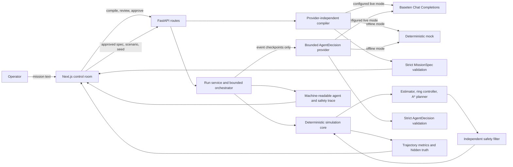

# FieldWeaver

Try the public demo at [fieldweaver.erebuzzz.tech](https://fieldweaver.erebuzzz.tech).
The backend API reference is at [fieldweaver-api.onrender.com/docs](https://fieldweaver-api.onrender.com/docs).
The free Render service sleeps after inactivity and can take about a minute to wake.
This is a public demo without user authentication; its 250 shared Baseten requests per
UTC day limit is a request allowance, not a spending cap. The allowance may already be
exhausted; offline mode and your own provider key do not use it.

FieldWeaver turns a short operator mission into a validated specification, then runs a
seeded 2D multi-robot source-localization simulation. The simulator keeps the source
coordinate out of mission compilation, controller observations, and agent observations.
An independent safety filter checks every proposed motion.

The project uses Baseten's OpenAI-compatible Chat Completions endpoint with
`meta-models/muse-spark-open-1026` when a server-side `BASETEN_API_KEY` is configured.
Without a key, the application uses an explicitly labelled deterministic mock.
A live mission compilation and a separate live obstacle-response trial succeeded on
November 4, 2026. These are individual checks, not a statistical model evaluation.

## What is implemented

- FastAPI contracts for public scenario metadata, mission compilation, simulation runs,
  and the latest in-process run evaluation.
- Strict, versioned Pydantic mission and agent-decision schemas. Unsupported mission
  requests return review notes and a clarification prompt.
- A deterministic 10 by 10 metre arena, seeded scalar-field noise, holonomic robot
  dynamics, a quadratic least-squares estimator, and a weighted-centroid baseline.
- Ring formation control, per-robot deterministic A* detours ending at assigned ring
  slots, inter-robot separation repulsion, and independent geometric safety checks.
- A bounded event-driven agent loop. It calls the provider only after monitored events,
  applies only known actions, and records a trace. The default caps are two model calls
  and two replans per run.
- A responsive Next.js workbench with mission review and approval, a Three.js 3D arena,
  an SVG 2D fallback, trajectory metrics, provider status, agent trace, and safety log.
  The web app also includes dedicated `/docs` and `/evaluation` pages, `/privacy` and
  `/security` policies, a `/license` page, and a themed custom 404 route.
- A seven-scenario evaluation suite comparing the proposed controller and baseline on
  ten shared seeds. It records 140 runs and publishes the exact JSON snapshot used by
  the evaluation page at `frontend/public/evaluation-report.json`.

This is simulation software. It does not control physical robots and does not claim a
formal safety proof. Multiple-source missions and SAM 3.1 scene segmentation are not
implemented. See [docs/ARCHITECTURE.md](docs/ARCHITECTURE.md) and
[docs/API_SETUP.md](docs/API_SETUP.md) for design boundaries and integration details.
The web app's `/docs` Field Guide explains the workflow and API. Read the
[Privacy Policy](docs/PRIVACY.md), [Security Policy](docs/SECURITY.md), and
[MIT License](LICENSE) before using or sharing an instance.

## Quick start for judges and users

No installation or API key is needed to try the [hosted workbench](https://fieldweaver.erebuzzz.tech/).
If the API was idle, give it time to wake and retry if the first request fails. The
[interactive Field Guide](https://fieldweaver.erebuzzz.tech/docs) also walks through setup
and a first run. For a repeatable run without model calls:

1. Open **Mission**, choose the **Open field** arena and **Balanced ring** swarm preset,
   and leave the seed at `42`.
2. Open **Advanced settings**. Set **Mission compiler** to **Offline mock** and
   **Agent decisions** to **Off**. This uses deterministic rules, not a live AI model.
3. Select **Compile mission**, then review the specification, assumptions, and any
   warnings. Address any clarification request before proceeding.
4. Check the approval box and select **Run approved mission**. Open the arena and use
   its playback controls to inspect the recorded trajectory.
5. Open **Run results** to inspect the outcome, metrics, and safety events. A timeout or
   infeasible route is a reported failure, not a successful localization.

To try live inference instead, choose **Baseten** and **Selected provider live** under
**Advanced settings**. On the hosted demo, leave the API key field blank to use the
shared server key, subject to its daily allowance. The compiler indicates whether the
result came from live inference or the offline mock. Agent decisions have a separate
mode selector; select **Selected provider live** there to enable live event-driven
decisions. A run may not trigger an agent event, and live decisions can vary.

The [evaluation page](https://fieldweaver.erebuzzz.tech/evaluation) explains the checked-in
results. The main 70-run comparison uses different agent settings for the two controllers;
see the same-agent ablation for a more controlled comparison.

## Architecture



The model cannot produce executable code, controller gains, routes, actuator commands,
or changes to safety limits. The application maps validated action enums to deterministic
behaviours and checks proposed motion independently. Model calls do not occur in the
per-tick controller loop.

The 3D scene renders simulation output in the browser. It does not run a second physics
engine or change robot state. Users can switch to the SVG view; WebGL failure or context
loss also falls back to that view. Blender, MuJoCo, and Isaac Sim are not part of the
current runtime. Blender could be used later to author optional browser assets; MuJoCo
or Isaac Sim would need a separate dynamics or sensor-validation goal.

## Run locally

Requirements: Git, Python 3.11 or newer, Node.js 20.9 or newer, and npm. An API key is
optional for offline mode. Clone the repository and enter it first:

```sh
git clone https://github.com/Erebuzzz/fieldweaver.git
cd fieldweaver
```

From PowerShell at the repository root:

```powershell
py -3 -m venv backend/.venv
.\backend\.venv\Scripts\python.exe -m pip install -e "backend[dev]"
npm ci --prefix frontend
if (-not (Test-Path .env)) { Copy-Item .env.example .env }
```

The example `.env` has a blank key, so a fresh setup uses offline mode unless a key is
already set in the process environment. The copy command preserves an existing `.env`.
Keep a server-default key in this backend environment file or the backend process
environment. Never put a key in frontend configuration. The browser API defaults to
`http://127.0.0.1:8000`; the optional
`NEXT_PUBLIC_API_BASE_URL` variable must be supplied to the frontend process if that
origin is changed.

Start the backend in one terminal:

```powershell
.\backend\.venv\Scripts\python.exe -m uvicorn app.main:app --app-dir backend --host 127.0.0.1 --port 8000
```

Start the frontend in a second terminal:

```powershell
npm --prefix frontend run dev -- --hostname 127.0.0.1
```

Open `http://127.0.0.1:3000`. API health and interactive OpenAPI documentation are at
`http://127.0.0.1:8000/api/health` and `http://127.0.0.1:8000/docs`.

For Bash or another POSIX shell, replace the virtual-environment setup with:

```sh
python3 -m venv backend/.venv
backend/.venv/bin/python -m pip install -e 'backend[dev]'
npm ci --prefix frontend
test -e .env || cp .env.example .env
```

Then run `backend/.venv/bin/python -m uvicorn app.main:app --app-dir backend --host 127.0.0.1 --port 8000`
and `npm --prefix frontend run dev -- --hostname 127.0.0.1` in separate terminals.

Leave both terminals running and follow the [first-run walkthrough](#quick-start-for-judges-and-users)
using the local workbench. Stop each server with `Ctrl+C` in its terminal.

If the page cannot reach the backend, verify that both processes are running and open
`http://127.0.0.1:8000/api/health` directly. If using different ports or hosts, set
`NEXT_PUBLIC_API_BASE_URL` for the frontend process and add the frontend origin to the
backend's comma-separated `FIELDWEAVER_CORS_ORIGINS`; restart both processes. The default
allowlist includes `http://localhost:3000` and `http://127.0.0.1:3000`. If a live request
reports missing or invalid credentials, check the selected provider, model access, and key,
or choose **Offline mock**. The 2D view is available if WebGL cannot render the 3D view.

## Using your own provider key

In **Advanced settings**, select Baseten, Meta Model API, or Fireworks, enter an API key
and a model ID available to that account, and select **Selected provider live** for the
compiler and, if desired, agent decisions. Fireworks requires you to enter a model ID.
Availability, costs, and model access depend on the provider and your account. Meta Model
API and Fireworks integrations have not been verified with live credentials; Baseten has.

The key entered in the form is held in the page's memory until cleared or closed and is
sent in requests to the FieldWeaver backend, which calls the selected provider. Use a
trusted instance and HTTPS for remote connections. Do not enter sensitive keys into an
untrusted deployment or expose them in screenshots. This is different from the hosted
server's default key, which stays on the backend and is not returned to the browser.

## Baseten configuration

To use your own server-default Baseten key locally, edit the root `.env` and set
`BASETEN_API_KEY` to your key, then restart the backend. The server reads that value
from the environment or the root `.env` file, with process environment taking priority. The
configured defaults are `https://inference.baseten.co/v1` and
`meta-models/muse-spark-open-1026`. The server-default key is not returned to the browser. Selecting
`Selected provider live` without a key returns an explicit provider error. `Automatic` uses live
only when the backend has a key; otherwise it uses the labelled offline mock.

The deterministic test suite uses mocked HTTP. On November 4, 2026, a live API
compilation returned a strictly validated specification and the resulting open-field
run converged with the agent disabled. A separate live agent requested a validated
detour in one dynamic-barrier trial, which converged. An earlier one-decision trial
selected a cautious profile and exhausted its decision budget. These limited checks do
not establish live-agent reliability. Mission and agent completions use a 4096-token
cap. See [docs/API_SETUP.md](docs/API_SETUP.md) for setup and test details.

## API routes

| Method and route | Purpose |
| --- | --- |
| `GET /` | Service identity and OpenAPI path |
| `GET /api/health` | Secret-free provider configuration, simulation limits, and safety envelope |
| `GET /api/scenarios` | Public scenario geometry and seed bounds, without source coordinates |
| `POST /api/missions/compile` | Compile text to a strict mission specification |
| `POST /api/simulations/run` | Run a seeded simulation and return frames, metrics, and traces |
| `GET /api/evaluations/latest` | Latest run evaluation held in the current backend process |
| `POST /api/scenes/segment` | Returns `503`; SAM is out of scope |

All API errors use a request-ID error envelope. The latest evaluation endpoint is
process-local and is not the aggregate report. The `/evaluation` page displays the
checked-in `frontend/public/evaluation-report.json`; the evaluation script writes the
same data to that public snapshot and the ignored `artifacts/evaluation_report.json`.

## Verification commands

Run backend commands from `backend/`:

```powershell
.venv\Scripts\python.exe -m pytest -v
.venv\Scripts\python.exe -m ruff check app tests ..\scripts
```

Run frontend checks from `frontend/`:

```powershell
npm run typecheck
npm run lint
npm run build
```

From the repository root, run the API smoke path and paired evaluation:

```powershell
.\backend\.venv\Scripts\python.exe scripts\smoke_test.py
.\backend\.venv\Scripts\python.exe scripts\run_evaluation.py
```

The smoke check covers health, public scenarios, mock mission compilation, a seeded
simulation, and the latest evaluation route. The evaluation run uses deterministic
seeds; local wall-clock timings naturally vary between executions.

## Evaluation snapshot

In the checked-in ten-seed suite, the quadratic controller with the offline mock agent succeeded in 40 of 70 runs
and the weighted-centroid baseline succeeded in 0 of 70. The proposed controller
terminated with `route_infeasible` in 20 runs and timed out in 10. All 70 baseline runs
timed out. The seeded `disturbed_corridor` case recovered in 10 of 10 trials with the
offline mock agent. These results are limited to the listed scenarios and seeds. They do
not establish general superiority or live-agent performance. The baseline had its agent
disabled, so this is not a matched agent comparison. In a separate same-agent-off
ablation the quadratic controller succeeded in 20 of 40 runs and the baseline in 0 of
40. Full metrics, variation,
and failure counts are in [docs/EVALUATION_RESULTS.md](docs/EVALUATION_RESULTS.md) and
the [raw evaluation JSON](frontend/public/evaluation-report.json), also shown at
`/evaluation`.

## Known limits

- The source-localization task supports one hidden source and 3 to 8 point robots.
- The safety filter is a geometric validator for this simulation, not a formal proof.
- The latest-run API state is process-local; it resets when the backend restarts.
- The evaluation sample contains ten seeds for each of seven scenarios. Broader
  robustness and cross-platform determinism have not been established.
- Live compiler and agent checks have passed individual trials, but live-agent
  reliability and latency distributions have not been evaluated.
- SAM 3.1 is not planned for this build. Physical hardware, persistent storage, and
  multi-source missions are outside the implemented scope.

The reproduction steps for the seeded disturbance demo are in
[docs/DEMO_SCRIPT.md](docs/DEMO_SCRIPT.md). Remaining limitations are summarized above
and in [docs/EVALUATION_RESULTS.md](docs/EVALUATION_RESULTS.md).
