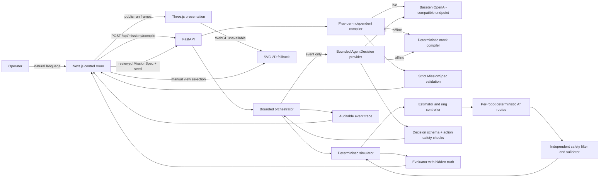
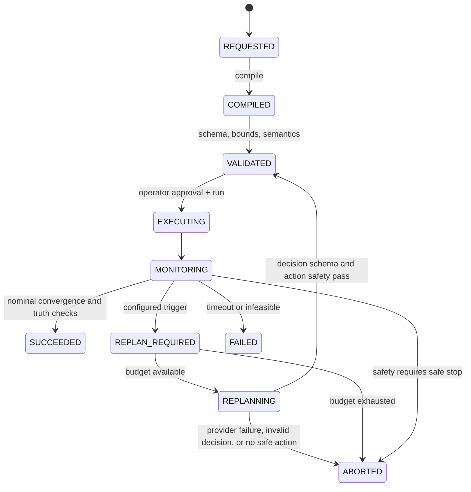

# FieldWeaver Architecture

The simulator and deterministic mock path are implemented and tested. Live Baseten
inference remains unverified after two generic smoke requests returned empty content.
The adapter uses Baseten's documented default output budget; see the
[API setup guide](API_SETUP.md) for provider behavior. Phase 5 SAM remains deferred
because supported access has not been verified.

## System view

## Non-negotiable boundaries

1. The simulator, controller, safety layer, and evaluator are plain Python modules
   with no FastAPI, Next.js, or provider imports.
2. Ground-truth source coordinates and field parameters live in the scenario and
   evaluation layer. They are never included in observation objects, compiler scene
   summaries, controller inputs, or agent observation summaries.
3. The model returns only a `MissionSpec` or a bounded `AgentDecision`. It never
   returns code, controller gains, raw actuator commands, endpoint URLs, or model IDs.
4. Every model response is parsed and validated server-side against strict Pydantic
   models with enums, numeric bounds, and `extra="forbid"`.
5. The safety layer owns hard limits. A model can request a more conservative profile
   but cannot relax speed, separation, clearance, boundary, or duration limits.
6. The model is not called inside the per-tick control loop. Mission compilation is
   one call. Agent decisions happen only at configured event checkpoints.
7. Reported metrics are computed from recorded simulation state and evaluator truth,
   never from model text.

## Runtime flow

A `REPLAN_REQUIRED` event pauses the deterministic loop, creates a bounded observation
summary, calls the provider at most `FIELDWEAVER_MAX_MODEL_CALLS` times per run,
validates the response, maps it to an already-implemented deterministic action, and
resumes only after the action passes safety checks.

## Simulation model

- Arena: bounded 2D rectangle, default 10 m by 10 m, coordinates in metres.
- Robots: 3 to 8 holonomic point robots with position, heading, and speed limit.
  Integration is explicit Euler at `dt = 0.1 s`. Speed is clamped by the mission and
  server envelope. Heading follows the velocity direction.
- Field: `f(p) = baseline + kappa * ||p - p*||^2 + noise`, where lower is closer.
  `p*` is hidden. Noise is deterministic from the run seed and can be none, bounded
  uniform, or seeded Gaussian.
- Observation: robot ID, time, own pose, heading, and scalar measurement. Team
  observations share only poses and scalar measurements. No source coordinate.
- Estimator: regularized least squares over samples of the isotropic quadratic model,
  with conditioning and curvature checks. Degenerate fits return the previous
  estimate or `None`, never an invented coordinate.
- Formation: deterministic order-preserving assignment of robots to evenly spaced ring
  slots around the current estimate. Each detour robot gets an independent A* route to
  its assigned slot. The follower combines route lookahead with obstacle and
  inter-robot separation repulsion. Final evaluation measures radial error against the
  true source. If any required route is missing or invalid, the run terminates as
  `route_infeasible` instead of moving the goal to a nearby free cell.
- Baseline: the same dynamics, ring objective, and safety filter with a simple
  inverse-measurement weighted-centroid estimator instead of the quadratic fit. It is
  intentionally weaker and is reported honestly on shared seeds.

## Safety layer

The independent validator runs before and after every integration step.

Checks:

- finite numeric states and valid geometry
- arena boundary margin
- robot-robot separation from mission constraints
- obstacle and restricted-region clearance from mission constraints
- speed and control magnitude limits
- no invalid step size or solver failure

When a proposed transition violates a limit, the filter scales velocities down or
stops the robot. If no safe transition exists, the run reverts to the last safe state
and records a safety intervention. Repeated safety events can trigger the bounded
agent loop; an unrecoverable state ends in a recorded safe failure or abort.

This is a geometric safety filter, not a formal proof of safety for arbitrary
dynamics.

## API contracts

| Route | Purpose | Error behavior |
| --- | --- | --- |
| `GET /api/health` | status, version, provider configuration, safety envelope | always secret-free |
| `GET /api/scenarios` | public scenario metadata, no source coordinates | 404 unknown scenario |
| `POST /api/missions/compile` | natural language to validated spec | 422 invalid/unsupported, 502 provider, 503 missing live key when live is forced |
| `POST /api/simulations/run` | validated spec + scenario + seed to trajectories and metrics | 422 invalid input, 500 unexpected |
| `GET /api/evaluations/latest` | latest run evaluation held in the current API process | 404 before a run or after restart |
| `POST /api/scenes/segment` | optional SAM adapter | 503 disabled until a verified endpoint exists |

All routes return a request ID header. Errors use
`{"error": {"code", "message", "details", "request_id"}}`.

## Evaluation and deferred features

- The aggregate evaluation report is generated by `scripts/run_evaluation.py`. The
  `/evaluation` page renders the checked-in `frontend/public/evaluation-report.json`;
  the API's `/api/evaluations/latest` route remains the most recent in-process run only.
- The browser Three.js scene consumes run data for presentation and has no authority
  over simulator state. The SVG renderer remains available as a manual and WebGL-failure
  fallback.
- SAM 3.1 segmentation: deferred until an eligible endpoint and credential are verified.
- Multiple sources, team splitting, moving sources: out of scope for the MVP.
- Physical robot deployment, alternative model providers, persistence database: out of scope.
- Formal safety guarantees: not claimed.

## Key files

- `backend/app/simulation/`: field, dynamics, estimator, controller, engine
- `backend/app/safety/`: validator and geometric filter
- `backend/app/evaluation/`: metrics from recorded trajectories
- `backend/app/services/`: compiler, decision provider, scenarios, orchestrator
- `backend/app/api/routes.py`: HTTP boundary
- `frontend/src/`: Next.js control room, Three.js scene, and SVG fallback
- `scripts/`: smoke test and reproducible evaluation suite
- `docs/`: build state, decisions, evaluation protocol, prior-work boundary, demo script
